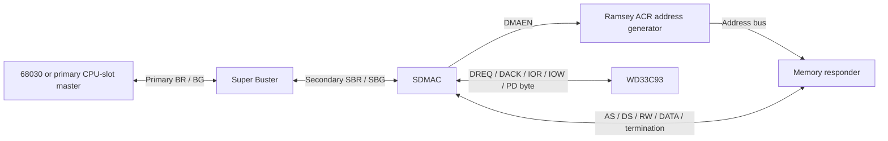

# A3000 DMA protocol and verification

Research baseline: 21 November 2026, `stable-update-release`, RTL commit
`654528af6cf2adc2526a234d503b91b3e8777059`. The tests under
`RTL/cocotb/DMA/` exercise the replacement through its socket pins. They model
the surrounding hardware at transaction level; passing them does not certify
electrical timing or an accelerator implementation.

## Primary sources

Page numbers below distinguish printed pages from PDF page indices (one-based).

| Source | Relevant material |
| --- | --- |
| [Motorola MC68030 User's Manual](MC68030UM.pdf), also [NXP archive](https://www.nxp.com/docs/en/reference-manual/MC68030UM.pdf) | Section 7, especially 7.1.4-7.1.7, Table 7-1, 7.2.8, 7.3.1-7.3.5, 7.7; printed 7-5, 7-7, 7-27, 7-48 onward, 7-97 through 7-100; PDF 166, 168, 188, 209 onward, 258-261. Figure 7-60 was visually inspected. |
| [A3000T Service Manual](Commodore/Commodore_A3000T_Service_Manual.pdf) | Buster section 2.16 (Level 1), arbitration printed 2-52/PDF 58; SDMAC section 2.17, printed 2-53 onward; Ramsey DMA support printed 2-60/PDF 66. |
| [A3000 schematic redraw](Commodore/A3000.pdf) | Visually inspected PDF 14-16: drawing 313311 rev C, sheets 16 (Buster), 17 (SCSI/SDMAC), 18 (Ramsey). This is the 2014 AmigaWiki redraw of Commodore drawings, not a new board specification. |
| [Fat Buster II specification](https://www.devili.iki.fi/mirrors/haynie/chips/buster/docs/buster2.pdf) | Section 2.7.1-2.7.2, PDF 18: primary arbitration versus the alternate 68030 SBR/SBG channel. The complete PDF was downloaded and inspected; the older service-manual Level 1 implementation is not interchangeable with this version. |
| [A3000 Local Bus Expansion Slot Specification](https://www.devili.iki.fi/mirrors/haynie/systems/amiga3k/docs/a3kcpu.pdf), revision 2.0 | Sections 2.2.1-2.2.2: primary takeover and secondary fast arbitration. |
| [Ramsey chip specification](https://megaburken.net/~patrik/A3000/390541-0x_Ramsey_specification.pdf) | Printed 6-35/PDF 7, visually inspected: DMA counter behavior and explicit -04/-07 differences. |
| [WD33C93B data sheet](WD33C93/WD33C93B_WesternDigital.pdf) | Figures 6-7/6-8 and sections 6.1.7/6.1.8, printed 24-49/24-50, PDF 55/56, visually inspected. Used for byte-handshake ordering, not certification of every WD33C93A speed grade. |

## The actual motherboard boundary

The schematic connects SDMAC U802 pin 81 (`BR`) to `_SBR`, and pin 82 (`BG`)
to `_SBG`. Those nets reach Buster U700's secondary channel. SDMAC pin 83
joins the shared `_BGACK` net. Buster's primary `_BR`/`_BG` pair is a different
connection to the CPU/CPU-slot arbitration path. A test that treats SDMAC's
grant as an immediate CPU response omits an important part of this boundary.



BGACK and the local cycle signals are shared; the arrows above show functional
roles rather than every schematic connection.

Buster arbitrates the secondary local master and expansion masters, controls
expansion buffers, and translates local cycles to expansion-bus cycles. For
an SDMAC transfer to local RAM it is not the address generator or the data
buffer. Expansion-memory accesses can additionally depend on Buster's cycle
translation and returned port width. [Service manual, section 2.16; schematic
sheets 16-18.]

Ramsey U890 receives `_DMAEN`, AS, STERM and DSACK0. It supplies the DMA address
from ACR while DMAEN is low. SDMAC has only A[6:2] as address inputs, rather
than a full DMA address output. The full-address scoreboard consequently checks
the modeled Ramsey/socket interaction, not a nonexistent address generator
inside ReSDMAC. Fat Gary supplies the SDMAC select at $00DD0000-$00DD3FFF;
ACR is offset $0C and is externally terminated by Ramsey. Its register is 32
bits, but Ramsey's physical data port is only D[31:24] (specification 6-30/6-31
and schematic sheet 18). A CPU longword access therefore takes four byte-port
bus cycles at $00DD000C through $00DD000F, each acknowledged with DSACK1:0=`10`.

The WD33C93A U800 connects its byte port to SDMAC PD[7:0], with DREQ, DACK,
IOR and IOW providing the DMA handshake. This is the processor-side interface
of the SCSI controller, not the SCSI cable REQ/ACK protocol. The harness does
not emulate SCSI commands, media, interrupts or disconnect/reselect.

## Ownership and Super Buster

At the secondary channel the sequence is:

1. SDMAC asserts SBR. Buster requests primary ownership and chooses a requester.
2. Buster returns SBG. A grant can arrive while the prior transaction or owner
   is still active; the grant alone is not permission to drive the bus.
3. SDMAC waits for AS, DSACK1:0, STERM and shared BGACK to be inactive.
4. SDMAC asserts BGACK and releases its request. Buster withdraws SBG.
5. SDMAC retains ownership for its cycles, then releases control and BGACK.

The new model implements this observable SBR/SBG contract, including delayed
service and an early grant followed by the previous transaction/owner clearing.
It does not claim to reproduce Buster's internal priority, fairness or exact
clock counts. The service manual describes a Level 1 arbiter synchronized to
7 MHz; a fixed delay in SCLK cycles is not a substitute for that implementation.

CPU-slot cards can become the primary master, taking over arbitration after
CBR/BOSS disables the onboard CPU, or participate in secondary arbitration.
The latter shares the primary request with Buster using opposite CPUCLK edges.
Neither arrangement makes an accelerator's internal CPU frequency the SDMAC
socket frequency. The harness uses the current RTL's 25 MHz simulation clock;
it does not infer TF4060, A3660, Z3660 or CSMk2 compatibility from a passed test.
[Local Bus Slot Specification, sections 2.2.1-2.2.2.]

## Transfer contract

The MC68030 has both asynchronous DSACK and synchronous STERM termination.
These rules apply to external bus masters too, but SDMAC implements a subset
of CPU capabilities: no CPU cache protocol, no cache burst request, and no
supported 8-bit memory port in the current sequencer.

| DSACK1:0 pin levels | Meaning |
| --- | --- |
| `11` | Wait; no asynchronous termination |
| `10` | 8-bit port, unsupported by this SDMAC implementation |
| `01` | 16-bit port; data on D[31:16] |
| `00` | 32-bit port; data on D[31:0] |

DSACK indicates port width, not how many requested bytes remain. STERM is a
32-bit-port response. The model varies DSACK assertion phase but holds its
encoding until AS releases, then removes it after 5 ns. An arbitrary one-clock
pulse ending while AS remains active is not a normal asynchronous slave
response; such experiments must be labeled separately from protocol compliance.
STERM is driven after a falling edge with setup before the next rising edge.

For reads, the responder supplies data. For writes, the master supplies data
and DS qualifies its validity. The responder must not consume write data just
because AS fell. Motorola permits all data lines to be driven even for narrow
transfers; the scoreboard selects the appropriate big-endian lanes using the
address, port width and transfer size. A 16-bit port always uses the upper
half, including the second half of a split longword.

The external size signal is named `_SIZ1` in this RTL, but its behavior follows
SIZ1: high selects a word, low a longword for the supported cycles. The top-level
comment saying the reverse must not become the test oracle.

On the peripheral side, DREQ asks for one byte; DACK and RE/WE qualify the
transfer. The model withdraws DREQ after acceptance, keeps input data through
RE release, and samples output data just before WE release. Inter-byte gaps
exercise backpressure. These are functional models with generous timing;
WD data-valid limits and FPGA pin delays still need separate timing analysis.

## Ramsey and transfer tails

Ramsey increments ACR at AS release during DMA. STERM or DSACK0 observed during
the cycle selects a four-byte increment; a 16-bit response selects two bytes.
Ramsey-04 masks A[1:0] on load. Ramsey-07 masks only A0 and forces a two-byte
increment when the current A1 is high. This differs from simply advancing an
address after each byte or after every FIFO entry. [Ramsey specification, 6-35.]

Software must use a supported alignment for its Ramsey revision. The model
performs the four dynamically sized CPU cycles in big-endian byte order,
presenting each byte on D[31:24]. In the last cycle, the address's low byte is
on that upper lane, so A1 appears on D25. ReSDMAC's `A1 <= MID[25]` is correct
for this interface. A single artificial 32-bit ACR write produces misleading
alignment failures and is not a valid test of that logic. Tests include
motherboard fast RAM and a Ramsey-07 word-aligned start, with ACR readback
through the same four-byte interface.

The original SDMAC description specifies a 16-byte FIFO. This RTL's default
FIFO is eight longwords (32 bytes), so lengths cross both historical and actual
boundaries. Memory-to-SCSI may prefetch beyond the peripheral transfer length;
the scoreboard distinguishes those reads from bytes actually sent to the WD.
SCSI-to-memory flush rounds an odd byte count up to a word. Only the final
padding byte is unconstrained; writes anywhere outside that allowed span fail.

FIFOEMPTY does not by itself mean a partial final word and all bus traffic are
finished. The driver yields the bus after FLUSH before polling status and
issuing STOP. Polling must not starve the simulated arbiter.

## Verification structure

- `dma_wrapper.v`: resolved bus drivers, Fat Gary address decode and Ramsey
  address selection. No internal signal forcing or deposits. It undefines
  `COCOTB_SIM` before compiling the DUT, selecting the hardware ACR-termination
  branch in `registers_term.v`; the older simulation shortcut incorrectly
  acknowledges ACR inside SDMAC for this board-level model. The wrapper supplies
  its own VCD dump, while `__ICARUS__` still selects simulation PLL/flash models.
- `board.py`: CPU accesses, secondary-channel arbitration, memory responder,
  Ramsey ACR, WD byte handshakes, bus monitor and JSON transaction records.
- `cocotb_dma.py`: expected payload and memory-footprint checks, transaction
  address walk, direction and ownership checks, alignment and timing scenarios.
- `test_dma.py`: separate simulator directories for each direction/termination
  pair. Existing component and smoke tests remain separate.

The baseline matrix covers lengths 1, 2, 3, 4, 15, 16, 17, 31, 32, 33 and 65
with zero/three added memory wait clocks, in both directions, using STERM,
32-bit DSACK and 16-bit DSACK. Additional cases exercise four busy-bus handoffs,
three DSACK phase offsets, fast RAM and a word-aligned start. Every wait is
bounded. Test traces are saved under `sim_build/dma_*/`.

Run from the repository root with the pinned test image:

```sh
docker run --rm -v "$PWD:/work" -w /work \
  mbtaylor1982/cocotb-iverilog@sha256:b62699a09a7e76ff80cf69932f222395886d661247f63b6a82285df22804cca6 \
  timeout 180s pytest RTL/cocotb/DMA -q
```

For one named cocotb test, pass `-e TESTCASE=motherboard_fast_ram` to Docker;
use pytest `-k` to select a direction/termination pair.

## Results against the unchanged candidate RTL

The pinned full-suite command completed in 90.21 seconds: **15 pytest launchers
passed and 3 failed**. All 12 pre-existing regressions passed. The six new DMA
launchers contain **186 cocotb scenarios: 165 passed, 21 failed**. No failing
case is skipped or marked as an expected failure; the suite remains red until
the firmware defect is resolved.

| Direction and termination | Passed | Failed |
| --- | ---: | ---: |
| SCSI to memory, STERM | 24 | 7 |
| SCSI to memory, 32-bit DSACK | 24 | 7 |
| SCSI to memory, 16-bit DSACK | 24 | 7 |
| Memory to SCSI, STERM | 31 | 0 |
| Memory to SCSI, 32-bit DSACK | 31 | 0 |
| Memory to SCSI, 16-bit DSACK | 31 | 0 |

All failures are extra memory writes beyond the allowed padded payload. They
occur for aligned lengths 3, 15 and 31 at both wait settings, and for the
word-aligned 17-byte case, across all three termination types. These leave
three bytes in the final partial FIFO longword. The smallest reproduction is:

```sh
docker run --rm -e TESTCASE=dma_transfer_005 -v "$PWD:/work" -w /work \
  mbtaylor1982/cocotb-iverilog@sha256:b62699a09a7e76ff80cf69932f222395886d661247f63b6a82285df22804cca6 \
  pytest RTL/cocotb/DMA -q -k 'to_memory and sterm'
```

That scenario requests bytes `a4 ed 36` at $00101000. It correctly observes
three peripheral reads, but nine 32-bit memory writes: **36 bytes instead of
four**. The waveform shows the FIFO occupancy count changing from zero to
eight when the partial entry is decremented, explaining the extra traversal
of the 32-byte FIFO. The payload comparison alone would pass; the memory-span
check is what exposes the overrun.

An isolated source-copy experiment gated the CPU sequencer's FIFO decrement
with `!FIFOEMPTY`; the selected failing 3-byte, 15-byte and word-aligned
17-byte STERM cases then passed. This supports an empty-counter decrement as
the cause. It is not a validated production fix: the counter, read pointer,
flush state and concurrent peripheral operations need review together. No
firmware RTL was changed by this work.

The harness was also checked with isolated negative controls:

| Deliberate source-copy mutation | Observed detection |
| --- | --- |
| Restore the pre-candidate data-output-enable expression | Resolved memory-read data contention |
| Select the wrong FIFO byte for the first SCSI byte | Payload mismatch (`ed` instead of `a4`) |
| Ignore the previous-cycle-clear condition | Resolved AS contention during an early grant |
| Change the correct ACR snoop from D25 to D1 | Word-aligned SCSI payload mismatch |

These experiments validate particular checks; they do not prove model
completeness. The corrected eight-bit ACR model passes the motherboard fast-RAM
cases unchanged. The word-aligned memory-to-SCSI cases also pass; the remaining
word-aligned SCSI-to-memory failure is a tail overrun, not an ACR snooping bug.

The full-run JUnit summary is generated as `sim_build/dma-review-results.xml`.
Each DMA simulator directory contains its cocotb JUnit file, `dma.vcd` and
per-scenario JSON records (including the four ACR write cycles, four ACR read
cycles, ownership counts, peripheral counts and memory transactions).

## Boundaries of this first harness

The later [RTL correction report](DMA_RTL_FIX_RESULTS.md) records the targeted
implementation and successful 354-case regression, superseding the failing
baseline above while retaining its evidence.

The subsequent [A3000 OS sequence extension](DMA_OS_SEQUENCES.md) retains
these stress cases and adds AmigaOS/Linux register sequences, immediate
FIFO-empty polling, longer completed transfers, and interrupted DMA prefixes.
It distinguishes hardware stress coverage from requests the OS would normally
send through programmed I/O.

This is functional verification, not TimeQuest sign-off. It does not yet model
full Zorro translation, bus-error recovery, reset during an active transfer,
cache coherency, WD interrupt sequencing, or an entire accelerator. There is
no evidence here for changing the clock architecture or adding DSACK pulse
stretching. First reproduce a protocol-valid failure, identify the responsible
component, and retain the failing case when making a targeted RTL correction.
